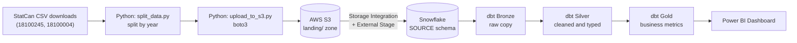
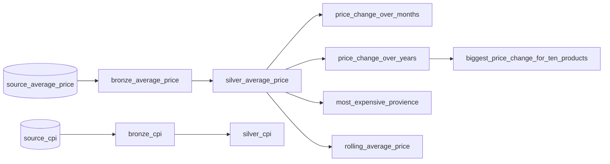

# 🛒 Statistics Canada Food Prices – End-to-End Data Pipeline & Power BI Dashboard

An end-to-end analytics project that takes raw **Statistics Canada** grocery price data and turns it into an interactive **Power BI dashboard**. It uses a modern cloud data stack:

**CSV files → Python → AWS S3 → Snowflake → dbt (Bronze / Silver / Gold) → Power BI**

The dashboard answers questions such as:

- How much did the price of a product change compared with last month and last year?
- Which 10 products had the biggest year-over-year price increase in Canada?
- How do price changes compare across provinces?
- Which provinces are the most expensive for each product?

---

## 📑 Table of Contents

1. [Project Overview](#-project-overview)
2. [Architecture](#-architecture)
3. [Tech Stack](#-tech-stack)
4. [Repository Structure](#-repository-structure)
5. [Data Sources](#-data-sources)
6. [Step-by-Step: What We Did](#-step-by-step-what-we-did)
7. [dbt Models in Detail](#-dbt-models-in-detail)
8. [Power BI Dashboard](#-power-bi-dashboard)
9. [How to Reproduce](#-how-to-reproduce)
10. [Security Notes](#-security-notes)
11. [Known Limitations & Future Improvements](#-known-limitations--future-improvements)

---

## 📌 Project Overview

Statistics Canada publishes monthly retail prices for common food items and the Consumer Price Index (CPI). The raw downloads are large flat CSV files. They are not ready for analysis, and they do not show trends such as month-over-month or year-over-year change.

This project builds a repeatable pipeline that:

1. Downloads the raw data and **splits it by year** (2017–2026).
2. **Uploads** the yearly files to an **AWS S3** data lake (landing zone).
3. **Loads** them into **Snowflake** using a storage integration, an external stage and `COPY INTO`.
4. **Transforms** the data with **dbt** using the **medallion architecture** (Bronze → Silver → Gold).
5. **Visualises** the Gold tables in **Power BI**.

---

## 🏗 Architecture



| Layer | Where | Purpose |
|-------|-------|---------|
| **Landing** | AWS S3 `landing/` | Raw yearly CSV files, partitioned by `year=` |
| **Source** | Snowflake `SOURCE` | Raw tables loaded with `COPY INTO` |
| **Bronze** | Snowflake `BRONZE` | 1-to-1 copy of the source, with no logic |
| **Silver** | Snowflake `SILVER` | Cleaned, renamed and correctly typed data |
| **Gold** | Snowflake `GOLD` | Analytics-ready tables that feed Power BI |

---

## 🧰 Tech Stack

| Tool | Used for |
|------|----------|
| **Python** (pandas, boto3) | Splitting data by year and uploading to S3 |
| **AWS S3** | Cloud storage / data lake landing zone |
| **Snowflake** | Cloud data warehouse |
| **dbt Core** (`dbt-snowflake`) | SQL transformations, lineage and modelling |
| **Power BI Desktop** | Interactive dashboard |
| **Git / GitHub** | Version control |

---

## 📂 Repository Structure

```text
statcan-food-prices/
├── data/
│   └── loading/
│       ├── average-price/        # average-price_2017.csv ... average-price_2026.csv
│       └── province-wise/        # provience-price_2017.csv ... provience-price_2026.csv
├── start/
│   └── split_data.py             # Step 1: split the raw CSVs into yearly files
├── src/
│   └── ingestion/
│       └── upload_to_s3.py       # Step 2: upload yearly files to S3
├── snowflake/
│   ├── load_average_price.sql    # Step 3: stage + file format + table + COPY INTO (average price)
│   └── load_cpi.sql              # Step 3: stage + file format + table + COPY INTO (CPI)
├── statscan_dbt/                 # Step 4: dbt project
│   ├── dbt_project.yml
│   ├── macros/generate_schema.sql
│   └── models/
│       ├── source/sources.yml
│       ├── bronze/               # bronze_average_price, bronze_cpi
│       ├── silver/               # silver_average_price, silver_cpi
│       └── gold/                 # 5 analytics models
├── power_bi/
│   └── power_bi_dashboard.pbix   # Step 5: the dashboard
└── datasets/                     # raw StatCan downloads (git-ignored)
```

---

## 📊 Data Sources

Both datasets come from [Statistics Canada](https://www150.statcan.gc.ca/n1/en/type/data).

| Table ID | Description | Local path | Snowflake source table |
|----------|-------------|------------|------------------------|
| **18-10-0245** | **Monthly average retail prices** for selected food products (e.g. "Beef stewing cuts, per kilogram"), by province and for Canada | `datasets/avg/18100245.csv` | `SOURCE_AVERAGE_PRICE` |
| **18-10-0004** | **Consumer Price Index (CPI)**, monthly, by product and product group, by province | `datasets/provience-wise/18100004.csv` | `SOURCE_CPI` |

Both files share the standard StatCan layout:
`REF_DATE, GEO, DGUID, Products (or "Products and product groups"), UOM, UOM_ID, SCALAR_FACTOR, SCALAR_ID, VECTOR, COORDINATE, VALUE, STATUS, SYMBOL, TERMINATED, DECIMALS`

> The raw CPI file goes back to 1914. We keep only **2017 – 2026** to match the span of the average-price data.

---

## 🪜 Step-by-Step: What We Did

### Step 1 – Download and split the raw data by year
**File:** [`start/split_data.py`](start/split_data.py)

The raw StatCan files are single large CSVs. To load them incrementally and keep the S3 layout tidy, we split them by year.

- Reads both raw CSVs with `pandas`.
- Loops over the years 2017 → 2026 and filters rows where `REF_DATE` starts with that year.
- Prints row counts per year, and checks that the sum of the yearly rows matches the original row count (a simple data-completeness check).
- Writes the output to `data/loading/average-price/average-price_<year>.csv` and `data/loading/province-wise/provience-price_<year>.csv`.

### Step 2 – Upload the yearly files to AWS S3 (landing zone)
**File:** [`src/ingestion/upload_to_s3.py`](src/ingestion/upload_to_s3.py)

- Uses `boto3` to upload files to the bucket `stats-canada-grocery-data`.
- Files are stored in a **Hive-style partitioned** layout:

  ```text
  s3://stats-canada-grocery-data/landing/average-price/year=2018/average-price_2018.csv
  s3://stats-canada-grocery-data/landing/cpi/year=2018/provience-price_2018.csv
  ```
- Checks that the local file exists before uploading, and handles `ClientError` / `BotoCoreError`.
- The `YEAR` constant at the top of the script is changed to upload each year one at a time.
- AWS credentials come from the standard AWS credential chain (`aws configure` or environment variables). They are **not** stored in code.

### Step 3 – Load S3 data into Snowflake
**Files:** [`snowflake/load_average_price.sql`](snowflake/load_average_price.sql), [`snowflake/load_cpi.sql`](snowflake/load_cpi.sql)

Both scripts run inside the `STATSCAN_ANALYTICS.SOURCE` schema and do four things:

1. **Stage** – `CREATE STAGE STATSCAN_S3_STAGE` points to `s3://stats-canada-grocery-data/landing/`. It authenticates through a Snowflake **storage integration** (`STATSCAN_S3_INT`), so no AWS keys are needed in SQL.
2. **File format** – `STATSCAN_CSV` is a CSV format with `PARSE_HEADER = TRUE` and quoted fields.
3. **Table** – `SOURCE_AVERAGE_PRICE` and `SOURCE_CPI` are created with `USING TEMPLATE` and `INFER_SCHEMA`. Snowflake builds the columns from the CSV header, so there is no manual DDL.
4. **Load** – `COPY INTO ... MATCH_BY_COLUMN_NAME = CASE_INSENSITIVE` loads every file under the prefix. `COPY INTO` tracks loaded files, so re-running it does not load the same file twice.

### Step 4 – Transform the data with dbt (Bronze → Silver → Gold)
**Folder:** [`statscan_dbt/`](statscan_dbt)

dbt reads the Snowflake source tables and builds each layer as a **table**.

- [`sources.yml`](statscan_dbt/models/source/sources.yml) registers `SOURCE_AVERAGE_PRICE` and `SOURCE_CPI` as dbt sources.
- [`generate_schema.sql`](statscan_dbt/macros/generate_schema.sql) is a custom macro that overrides dbt's default schema naming. Without it, dbt would create schemas such as `PUBLIC_BRONZE`. With it, models go to exactly `BRONZE`, `SILVER` and `GOLD`.
- [`dbt_project.yml`](statscan_dbt/dbt_project.yml) maps each folder to its schema and sets `materialized: table`.

See [dbt Models in Detail](#-dbt-models-in-detail) below.

### Step 5 – Build the Power BI dashboard
**File:** [`power_bi/power_bi_dashboard.pbix`](power_bi/power_bi_dashboard.pbix)

Power BI connects to the Snowflake `GOLD` schema. See [Power BI Dashboard](#-power-bi-dashboard).

---

## 🧱 dbt Models in Detail

### 🥉 Bronze – raw copy

| Model | Logic |
|-------|-------|
| `bronze_average_price` | `SELECT * FROM source_average_price` |
| `bronze_cpi` | `SELECT * FROM source_cpi` |

Bronze keeps the raw data as it was loaded. It is the single point of entry from the source into dbt.

### 🥈 Silver – cleaned and typed

| Model | What it does |
|-------|--------------|
| `silver_average_price` | Converts `REF_DATE` (`2017-01`) to a real `DATE` (`2017-01-01`) using `TRY_TO_DATE`. Renames and casts columns to `reference_date`, `geography_location`, `dguid`, `products`, `coordinates` and `average_price` (`NUMBER(6,2)`). Uses `TRY_CAST`, so bad values become `NULL` instead of failing the run. |
| `silver_cpi` | Same cleaning for the CPI table, with the value column named `cpi_index`. |

### 🥇 Gold – business metrics (feed Power BI)

| Model | Business question | Technique |
|-------|-------------------|-----------|
| `price_change_over_months` | How much did the price change versus the previous month? | `LAG(average_price)` partitioned by province and product. Outputs `prev_month_price`, `price_change` and `pct_change`. |
| `price_change_over_years` | How much did the price change versus the same month last year? | `LAG(average_price, 12)`. Outputs `prev_year_price`, `price_change` and `precentage_change`. |
| `biggest_price_change_for_ten_products` | Which 10 products rose the most year over year in Canada? | Filters `price_change_over_years` to the latest month and `Canada`, then ranks with `DENSE_RANK()` and keeps the top 10. |
| `most_expensive_provience` | Which 3 provinces are the most expensive for each product? | `DENSE_RANK() OVER (PARTITION BY products ORDER BY average_price DESC)` for the latest month, excluding `Canada`, keeping ranks 1–3. |
| `rolling_average_price` | What is the smoothed price trend? | 3-month and 12-month moving averages using window frames. The average is only reported when the window is full (`COUNT = 3` or `12`), which avoids misleading partial averages. |

All percentage changes use `NULLIF(prev, 0)` to avoid division-by-zero errors.

**Lineage**



---

## 📈 Power BI Dashboard

**File:** [`power_bi/power_bi_dashboard.pbix`](power_bi/power_bi_dashboard.pbix) (open with Power BI Desktop)

The report is connected to the Snowflake **GOLD** tables: `PRICE_CHANGE_OVER_MONTHS`, `PRICE_CHANGE_OVER_YEARS` and `BIGGEST_PRICE_CHANGE_FOR_TEN_PRODUCTS`. It also uses small lookup tables (**Product Lookup**, **Date Lookup**, **Province Lookup**) that drive the slicers.

**Page 1 includes:**

| Visual | Type | Shows |
|--------|------|-------|
| Product slicer | Advanced slicer | Pick a product |
| Date slicer | Slicer | Pick a month |
| Province slicer | Slicer | Pick a province or Canada |
| Average price | Card | Current average price for the selection |
| Previous month price | Card | Price one month earlier |
| Price change | Card | Month-over-month change in dollars |
| Year-over-year % change by province | Clustered bar chart | Compares provinces by `% change` versus last year |
| Top 10 price increases | Table | Products, province, date, previous-year price, current price and price change for the 10 biggest year-over-year increases in Canada |

> 📷 *Tip: add a screenshot of your dashboard to a `docs/` folder and embed it here with ``.*

---

## 🚀 How to Reproduce

### Prerequisites

- Python 3.10+
- An AWS account with an S3 bucket, and the AWS CLI configured (`aws configure`)
- A Snowflake account with the database `STATSCAN_ANALYTICS`, schemas `SOURCE`, `BRONZE`, `SILVER` and `GOLD`, and a storage integration `STATSCAN_S3_INT` that can read the bucket
- Power BI Desktop

### 1. Set up the environment

```powershell
python -m venv .venv
.venv\Scripts\activate
pip install pandas boto3 dbt-core dbt-snowflake
```

### 2. Download the raw data

Download tables **18-10-0245** and **18-10-0004** from Statistics Canada as CSV and place them at:

```text
datasets/avg/18100245.csv
datasets/provience-wise/18100004.csv
```

### 3. Split by year

```powershell
python start/split_data.py
```

### 4. Upload to S3

Edit `YEAR` in `src/ingestion/upload_to_s3.py` (and `BUCKET_NAME` if needed), then run it once per year:

```powershell
python src/ingestion/upload_to_s3.py
```

### 5. Load into Snowflake

Run these in a Snowflake worksheet:

```text
snowflake/load_average_price.sql
snowflake/load_cpi.sql
```

### 6. Run dbt

Create a `profile.yml` / `profiles.yml` for the `statscan_dbt` profile with your Snowflake connection details. These files are git-ignored.

```powershell
cd statscan_dbt
dbt debug      # check the connection
dbt run        # build bronze, silver and gold
```

### 7. Open the dashboard

Open `power_bi/power_bi_dashboard.pbix` in Power BI Desktop. Update the Snowflake data source credentials if prompted, then **Refresh**.

---

## 🔐 Security Notes

Credentials are never committed. [`.gitignore`](.gitignore) excludes:

- `.env`, `*.pem`, `*.key`, `credentials*` and `.aws/`
- dbt `profile.yml` and `profiles.yml`, which contain warehouse credentials
- `datasets/` (raw downloads), `logs/`, `.venv/` and `.vscode/`

Snowflake reads from S3 through a **storage integration** (IAM role based), not access keys.

---

## 🔭 Known Limitations & Future Improvements

- `silver_cpi` is built, but no Gold model or dashboard visual uses it yet. A natural next step is a CPI trend page, or a comparison of food prices against overall inflation.
- The `most_expensive_provience` and `rolling_average_price` Gold models exist and are ready to use, but are not yet on the dashboard page.
- Add dbt **tests** (`not_null`, `unique`, `accepted_values`) and documentation (`dbt docs generate`).
- Make `upload_to_s3.py` loop over all years instead of using a single `YEAR` constant.
- Add `requirements.txt` and an orchestrator (Airflow, Prefect or GitHub Actions) to schedule monthly refreshes.
- Make `incremental` dbt models so only new months are processed.
- Fix the spelling in model and column names (`provience` → `province`, `precentage_change` → `percentage_change`). This needs a matching update in Power BI.

---

## 👤 Author

Built as a data engineering and analytics portfolio project using Statistics Canada open data.

> Contains information licensed under the [Statistics Canada Open Licence](https://www.statcan.gc.ca/en/reference/licence).

