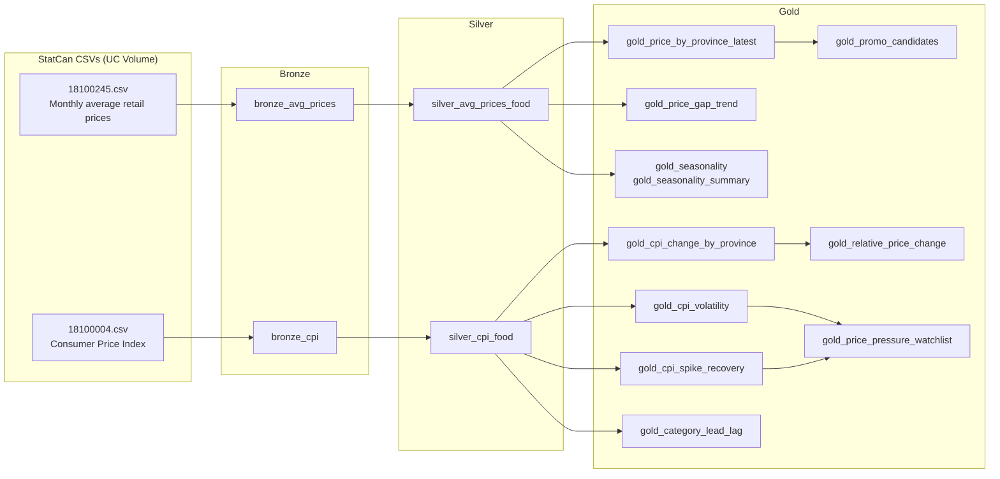

# Canadian Food Prices: A Medallion Pipeline on Statistics Canada Data

This project turns two raw Statistics Canada tables into a set of analysis-ready tables that answer
business questions about Canadian food prices. Examples: how much food got more expensive in each
province since 2017, who pays the most for milk today, which food groups are the most volatile, and
which provinces recovered fastest from the 2021–2023 food-inflation spike.

The pipeline runs on **Databricks** (PySpark + Delta tables in Unity Catalog). It follows the
**medallion architecture**, with one notebook per layer:

| Layer  | Notebook                                   | What it does                                                                 |
|--------|--------------------------------------------|------------------------------------------------------------------------------|
| Bronze | [`bronze-data.ipynb`](bronze-data.ipynb)   | Loads the raw StatCan CSVs as-is, with an explicit schema and lineage columns |
| Silver | [`silver-data.ipynb`](silver-data.ipynb)   | Keeps only food, Canada and the 10 provinces, cleans names and dates, renames columns |
| Gold   | [`gold-data.ipynb`](gold-data.ipynb)       | Builds one table per business question, plus validation queries             |



---

## 1. Source data

Both datasets come from Statistics Canada and are downloaded as full-table CSVs.

| StatCan table | File | What it measures | Product column | Raw rows |
|---|---|---|---|---|
| [18-10-0245-01](https://www150.statcan.gc.ca/t1/tbl1/en/tv.action?pid=1810024501), Monthly average retail prices for selected products | `18100245.csv` | Average shelf price in dollars of specific items (for example "Milk, 2 litres") | `products` | 141,432 |
| [18-10-0004-01](https://www150.statcan.gc.ca/t1/tbl1/en/tv.action?pid=1810000401), Consumer Price Index, monthly, not seasonally adjusted | `18100004.csv` | Price index (2002 = 100) for product groups, such as "Fresh vegetables" | `products_and_product_groups` | 1,154,918 |

The two tables answer different questions, and the gold layer uses each for the job it fits:

- **Average prices** are dollar amounts, so you can compare **levels** across provinces ("Milk costs
  more in Ontario than in PEI").
- **CPI** is an index that tracks **change over time** within a region. You can't compare index
  levels between provinces, but you can compare percentage changes ("Food rose 45% in PEI vs. 41%
  nationally").

Both files use the standard StatCan layout: `REF_DATE, GEO, DGUID, <product column>, UOM, UOM_ID,
SCALAR_FACTOR, SCALAR_ID, VECTOR, COORDINATE, VALUE, STATUS, SYMBOL, TERMINATED, DECIMALS`.

---

## 2. Setup

### Prerequisites

- A Databricks workspace with Unity Catalog. Serverless compute works; the notebooks were authored
  on environment version 6.
- A catalog named `data-bricks-fundamentals` with the `default` schema. If your catalog has a
  different name, see the note below.

### Steps

1. **Download the CSVs** from the StatCan pages linked above ("Download options → Download entire
   table"). Unzip them to get `18100245.csv` and `18100004.csv`.
2. **Create a Volume** named `average-price-price` in `data-bricks-fundamentals.default` and upload
   the files into this layout:
   ```
   /Volumes/data-bricks-fundamentals/default/average-price-price/
   ├── avg/18100245.csv
   └── provience-wise/18100004.csv
   ```
3. **Import the three notebooks** into your workspace.
4. **Run them in order**: `bronze-data` → `silver-data` → `gold-data`. Each notebook reads only
   tables written by the one before it.

> **Using a different catalog?** Update the `base` path in `bronze-data.ipynb`, the catalog name in
> `to_bronze()`, and the `cat` variable at the top of the silver and gold notebooks. Update the
> catalog name in the `%sql` check cells too.

---

## 3. Bronze layer: raw ingestion

**Notebook:** `bronze-data.ipynb` · **Output:** `bronze_avg_prices`, `bronze_cpi`

The goal is a faithful, queryable copy of the source files, with no business logic.

1. **Explicit schema.** The notebook defines one `StructType` (`statcan_schema`) for both files and
   passes only the product column name. This avoids the cost of schema inference on a file with
   about 1.1 M rows. It also fixes the types: `value` is `Double`, and the ID columns are `Integer`.
   `ref_date` stays a string at this stage.
2. **Read the CSVs** from the Volume with `header=true`.
3. **Sanity checks.** The notebook prints row counts (expect **141,432** and **1,154,918**), shows
   sample rows, shows row counts per `geo`, and shows the min/max `ref_date`.
4. **Write to Delta** with `to_bronze()`. This adds two lineage columns:
   - `_ingested_at`: the load timestamp
   - `_source_file`: the source file name, from Spark's `_metadata.file_name`

   Tables are written in `overwrite` mode, so you can re-run the notebook after downloading a newer
   StatCan file.
5. **Verification query.** A `%sql` cell counts rows in both bronze tables.

---

## 4. Silver layer: clean and conform

**Notebook:** `silver-data.ipynb` · **Output:** `silver_cpi_food`, `silver_avg_prices_food`

The silver layer narrows the raw data to the scope of the analysis and gives both tables the same
shape: `month`, `geo`, `product`, `<value>`.

### Rules that apply to both tables

- **Geography:** keep `Canada` plus the 10 provinces. This drops the territories and the city-level
  series in the CPI table.
- **Dates:** parse `ref_date` (`yyyy-MM`) into a real `DATE` column called `month`, set to the first
  of the month.

### `silver_cpi_food`: CPI for 32 food groups

| Step | Logic |
|---|---|
| Product scope | Keep 32 food groups. The list runs from the top-level `Food` series down to items such as `Butter`, `Eggs` and `Coffee and tea`, and covers meat, fish, dairy, bakery, fruit, vegetables and other food. |
| Time scope | `month >= 2017-01-01`, the first month of the average-price table, so both datasets cover the same period |
| Columns | `month`, `geo`, `product` (renamed from `products_and_product_groups`), `cpi_index` (renamed from `value`) |
| Expected rows | **41,184** (11 geos × 32 groups × 117 months) |

### `silver_avg_prices_food`: average retail prices for food items

| Step | Logic |
|---|---|
| Name cleanup | `trim()` the product name, because some StatCan names have trailing spaces that would break joins and filters |
| Product scope | Remove the four non-food items in the table: deodorant, toothpaste, shampoo and laundry detergent |
| Missing values | Drop rows where `value` is null. StatCan doesn't publish every product in every province every month. |
| Columns | `month`, `geo`, `product`, `avg_price` |
| Expected rows | **135,140** |

---

## 5. Gold layer: one table per business question

**Notebook:** `gold-data.ipynb`

Each gold table answers one or more numbered business questions (Q1–Q15). All of them are
overwritten on every run, and they always use the **latest month available** in silver, so the
answers update when you load a newer StatCan file.

### Gold 1: `gold_cpi_change_by_province` (Q1–Q3)
**How much have food prices risen in each province since 2017, and how does each province compare
with the national figure?**

- Baseline: the **average CPI over calendar year 2017**, per province and food group.
- Recent level: the **average CPI over the latest 12 months**. Averaging over 12 months smooths out
  seasonal noise.
- `pct_change = index_recent / index_2017 − 1`
- `pts_vs_canada`: the province's change minus Canada's change, in percentage points.
- `rank_in_product`: provinces ranked by increase within each food group; 1 means the biggest rise.
- Grain: province × food group (10 × 32 = 320 rows).

### Gold 2: `gold_price_by_province_latest` (Q6, Q7, Q9)
**Who pays the most for each product today, and how far above or below the national average are
they?**

- `price_3m`: the average retail price over the **latest 3 months**, per province and product.
- `pct_vs_canada`: the province's price relative to the Canada-wide price, in percent.
- `rank_most_expensive`: 1 means the most expensive province for that product.

### Gold 3: `gold_cpi_volatility` (Q5)
**Which food groups have the most stable prices, and which swing the most?**

- Compute the month-over-month % change in CPI per series.
- `volatility` is the **standard deviation** of those monthly changes.
- `rank_most_stable`: 1 means the most stable group in that geography. Canada is included.

### Gold 4: `gold_cpi_spike_recovery` (Q4, Q11)
**How large was the 2021–2023 food-inflation spike, and how quickly did each province cool down?**

- `yoy_pct`: the year-over-year % change (CPI vs. the same month a year earlier).
- `peak_month` / `peak_yoy_pct`: the highest YoY reading between **Jan 2021 and Dec 2023**. If two
  months tie, the earliest one wins.
- `cooled_month`: the first month **after the peak** where YoY inflation drops below
  `COOL_LEVEL = 3.0%`.
- `months_to_cool`: the number of months from the peak to `cooled_month`. It is null if the series
  hasn't cooled yet.
- `latest_yoy_pct`: the most recent YoY reading.
- `rank_biggest_spike`: the food groups in each geography ranked by peak YoY.

### Gold 5: `gold_price_gap_trend` (Q8)
**Is the price gap between the most and least expensive provinces shrinking?**

- Compute the yearly average price per product and province (provinces only).
- For each product and year, record the highest and lowest province with their prices, and
  `gap_pct = highest / lowest − 1`.
- `months_in_year` flags partial years, such as the current year.

### Gold 6: `gold_seasonality` and `gold_seasonality_summary` (Q10)
**Which products have seasonal price patterns, and when are they cheapest and most expensive?**

- Canada only, full years 2017–2025, so the partial current year doesn't bias the result.
- Each month's price is divided by that product's average for the year, which removes inflation. The
  ratios are then averaged by calendar month to give the `seasonal_index`. A value of 1.05 means
  prices in that month are typically 5% above the yearly average.
- The summary table gives each product's `swing_pct` (peak index minus trough index), its
  `priciest_month` and its `cheapest_month`.

### Gold 7: `gold_category_lead_lag` (Q12)
**Do price changes in one food category show up later in another?**

- Canada only. Uses YoY CPI for the 7 major food categories (meat, fish, dairy and eggs, bakery and
  cereal, fruit, vegetables, other food).
- For each pair of categories (leader, follower), the notebook correlates the leader's YoY with the
  follower's YoY shifted **0–6 months later**. It keeps the lag with the highest correlation.
- Output: `leader`, `follower`, `lag_months`, `correlation`. This shows co-movement, not causation.

### Gold 8: `gold_price_pressure_watchlist` (Q13)
**Which province and food-group combinations are under the most price pressure right now?**

- Joins Gold 4 (`latest_yoy_pct`) with Gold 3 (`volatility`), for provinces only.
- `on_watchlist` is true when the latest YoY inflation is **≥ 5%**.
- `rank_in_province`: food groups ranked by current YoY inflation within each province.

### Gold 9: `gold_promo_candidates` (Q14)
**In each province, which products are most overpriced relative to the national average, making
them candidates for promotions or store brands?**

- Starts from Gold 2 and keeps products priced **above** the Canada average.
- Keeps the **top 10 per province** by `pct_vs_canada`.

### Gold 10: `gold_relative_price_change` (Q15)
**Which food groups got more expensive than food overall, and which got relatively cheaper?**

- Starts from Gold 1 and compares each group's change since 2017 against the `Food` total, both per
  province (`vs_food_pts`) and nationally (`canada_vs_food_pts`).
- `label`: `much pricier` (≥ +5 pts), `relatively cheaper` (≤ −5 pts), or `in line`.

> **Note:** The code that builds Gold 8–10 was in the original `Supply-Chain.ipynb` (commit
> `3a39726`) and was left out when that notebook was split into bronze/silver/gold. The validation
> queries for these three tables are still in `gold-data.ipynb`, so you need to restore that code
> cell, placed after Gold 1–4, before those checks will run.

---

## 6. Validation and key findings

Every layer ends with a check against a known expected result, so a bad download or a logic change
shows up right away. The expected values below come from the data loaded when the notebooks were
written; they will change when StatCan publishes new months.

| Check | Expected result |
|---|---|
| Bronze row counts | avg prices **141,432**, CPI **1,154,918** |
| Silver row counts | CPI food **41,184**, avg prices food **135,140** |
| Q1–3: Food CPI change since 2017 | Canada **+40.9%**. Highest: **PEI +45.1%**. Lowest: **Newfoundland and Labrador +37.3%** |
| Q6: Milk, 2 litres (last 3 months) | Most expensive **Ontario $5.92**. Cheapest **PEI $4.73** |
| Q5: Volatility in Canada | Most stable **Food (0.57)**. Most volatile **Fresh vegetables (3.76)** |
| Q8: Milk province price gap | Narrowed from **29.5% (2017)** to **25.9% (2025)** |
| Q11: Cooling after the spike (Food) | Fastest **British Columbia (15 months)**. Slowest **New Brunswick (27 months)** |
| Q13: Price-pressure watchlist | **50 of 320** province × category combinations at ≥ 5% YoY |
| Q14: BC promo candidates | **Potatoes 4.54 kg (+49.2%)**, **Broccoli (+39.2%)**, **Avocado (+26.5%)** vs. Canada |
| Q15: Change vs. overall food (Canada) | Biggest riser **Fresh or frozen beef (+38.3 pts)**. Biggest laggard **Cheese (−16.0 pts)** |

---

## 7. Caveats

- **CPI is not a price level.** The CPI index can't tell you which province is more expensive, only
  how fast prices changed. Questions about price levels use the average-price table.
- **Average prices cover specific items** (a fixed size and type), not the whole food basket. Gaps
  can come from product mix, retailer coverage and sampling.
- **Missing series:** some products aren't published in every province or every month. Silver drops
  the null values, so a province can be missing from a product's ranking.
- **Rankings use `rank()`**, so ties share a rank. Gold 9 uses `row_number()` so the top-10 cut is
  exact.
- **Thresholds are business choices:** the 3% cool-down level, the 5% watchlist level, the ±5-point
  "much pricier" band, the 3-month and 12-month windows, and the 2021–2023 spike window. They're
  defined in the gold notebook, so you can change them there.
- **Lead–lag results show correlation only.** They suggest which categories move together and how far
  apart in time, not why.

---

## Repository layout

```
.
├── bronze-data.ipynb   # Raw CSV → Delta (bronze_avg_prices, bronze_cpi)
├── silver-data.ipynb   # Filter + clean (silver_cpi_food, silver_avg_prices_food)
├── gold-data.ipynb     # Business-question tables + validation queries
└── README.md
```

Source data: Statistics Canada, tables 18-10-0245-01 and 18-10-0004-01, used under the
[Statistics Canada Open Licence](https://www.statcan.gc.ca/en/reference/licence).
